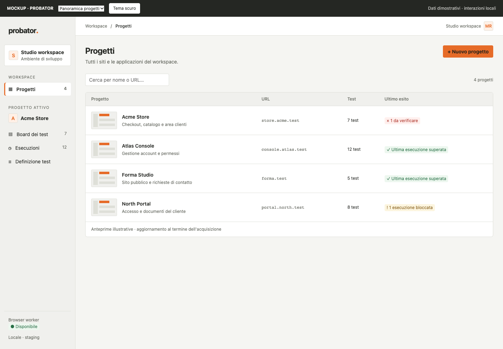
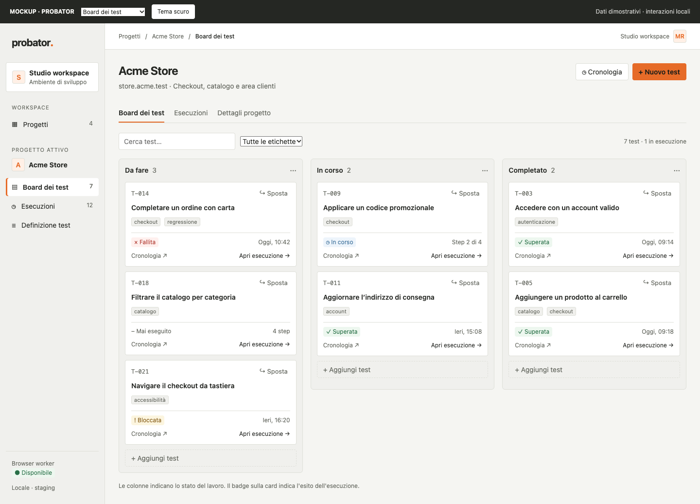
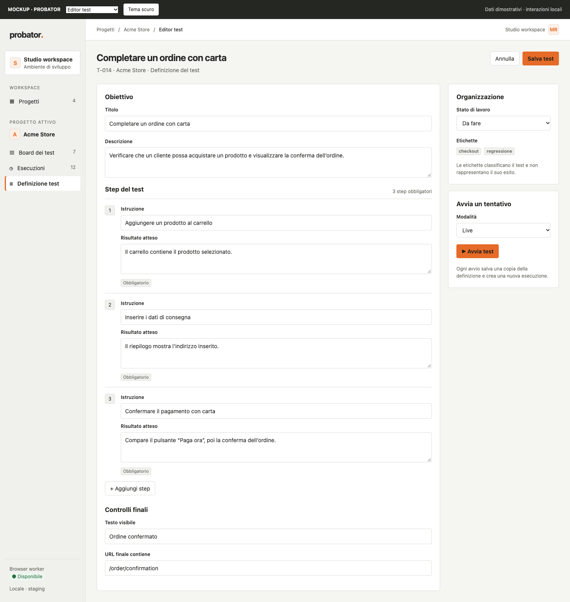
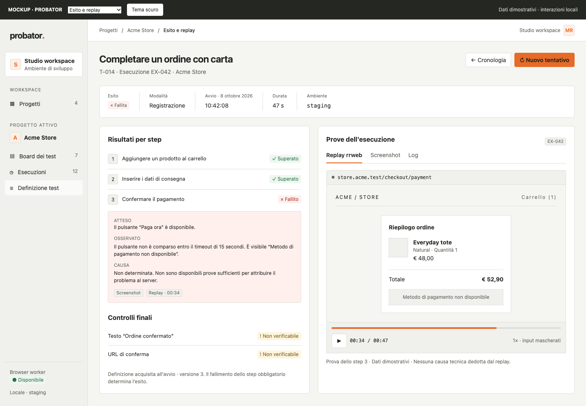
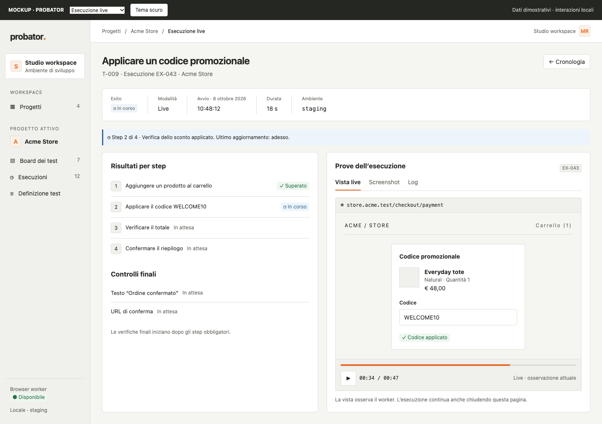
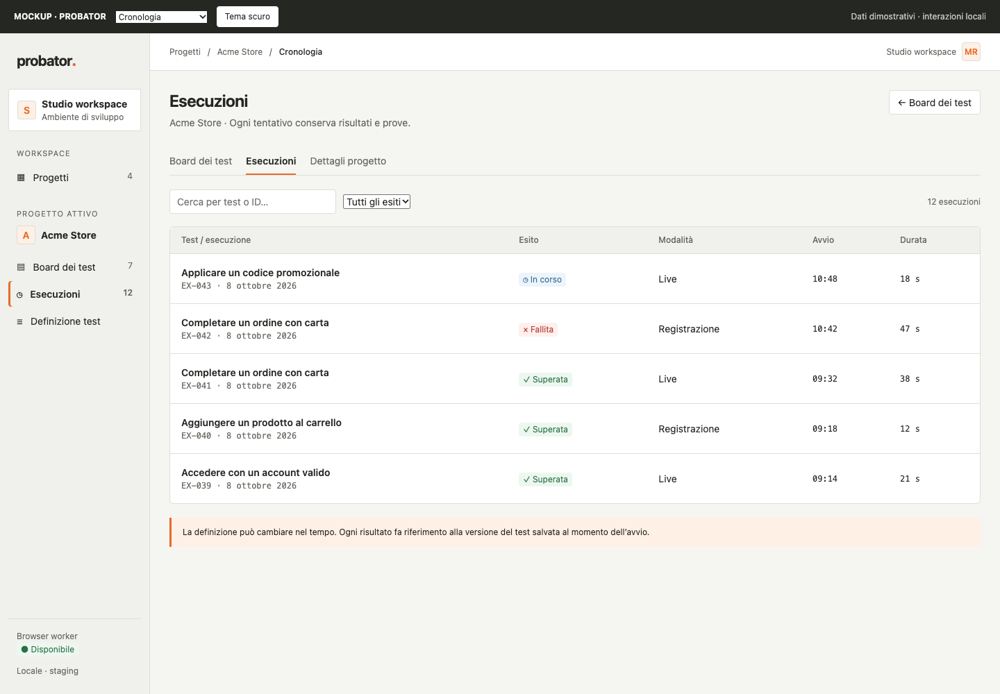
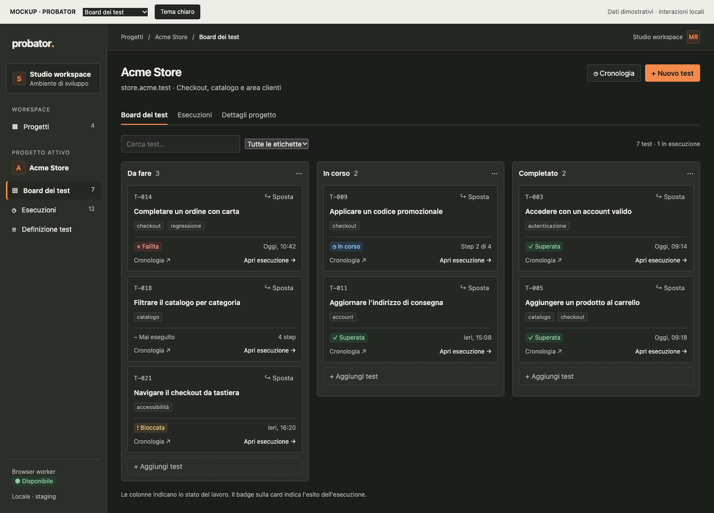
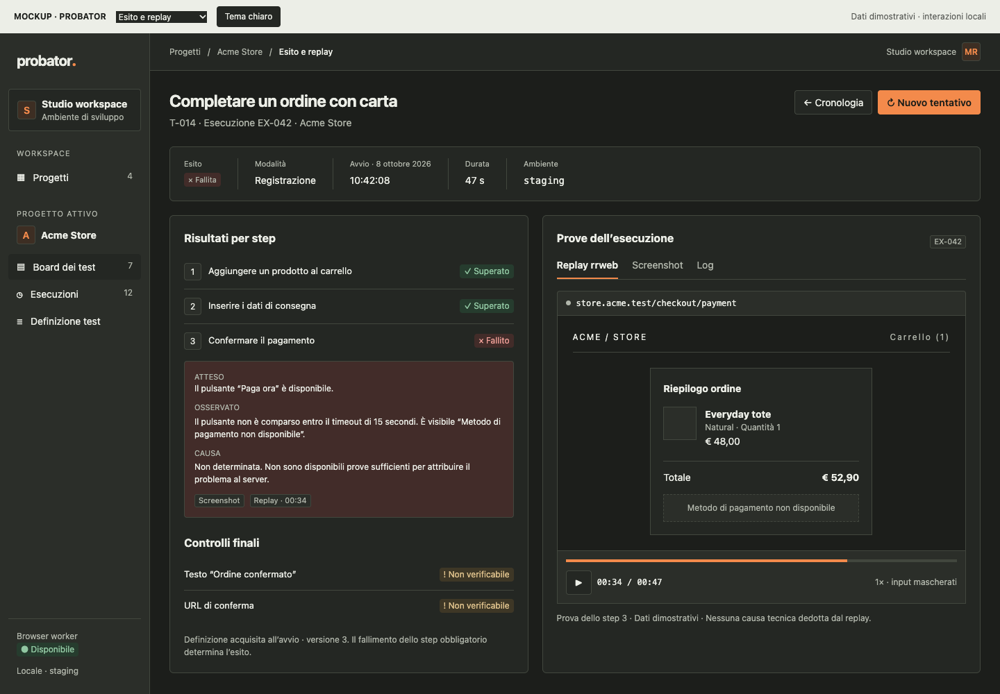
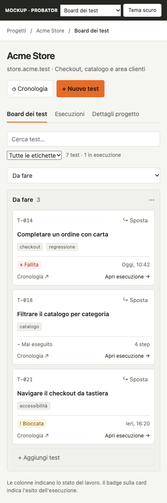
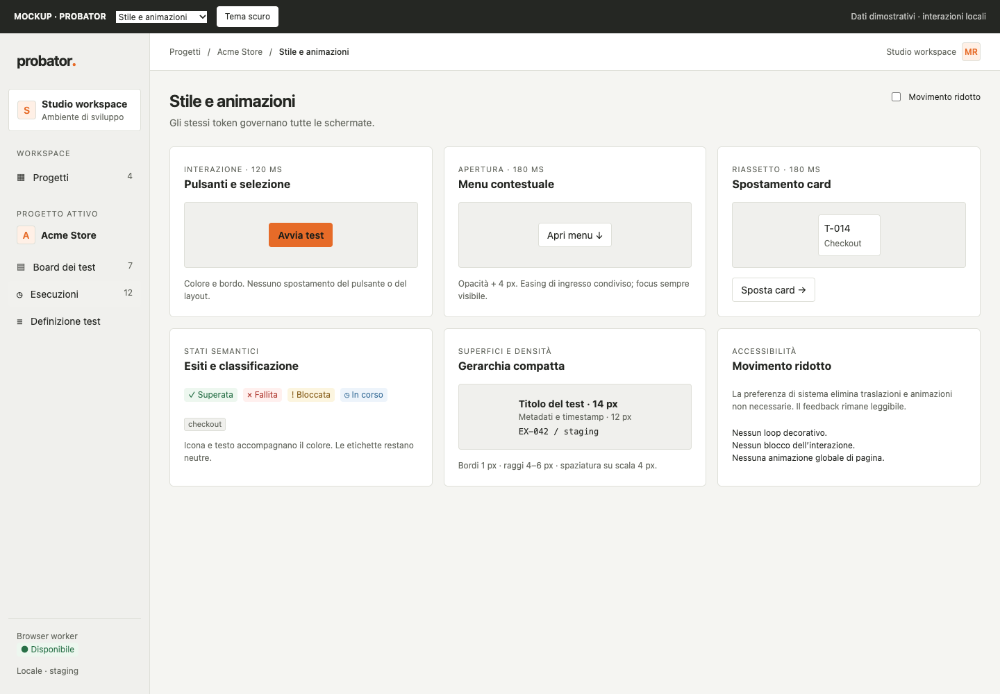

# Piano di implementazione: gestione progetti e test web

> **Stato dell'implementazione (8 ottobre 2026):** applicazione Next.js locale con persistenza e migrazioni gestite da Prisma, coda PostgreSQL durevole, worker Bun collegato al package `@probator/browser-engine`, progetti, board, editor versionato, spostamento/riordino accessibile, Live con screenshot completi e progressi, Registrazione rrweb senza mascheramento, manifest e replay con controlli. I chunk rrweb e la trace redatta sono salvati in MinIO; gli artefatti pronti si aprono tramite URL firmati temporanei. I frame Live aggiornano l'anteprima del progetto. La retention elimina esecuzioni/oggetti scaduti e riconcilia upload interrotti e orfani. Il contesto resta single-operator su loopback; il contenuto degli snapshot può includere dati sensibili. Restano la validazione visuale completa e i test end-to-end di MinIO/rrweb nel browser.

## Obiettivo e riferimenti

Realizzare la prima versione descritta in [project-test-management-spec.md](./project-test-management-spec.md), rispettando [development-guidelines.md](./development-guidelines.md). Il risultato deve coprire l'intero percorso: progetto → board → definizione del test → esecuzione → risultati e prove persistenti.

La coerenza visiva e delle animazioni è un requisito trasversale, da verificare in ogni fase. La direzione è quella di uno strumento operativo denso e leggibile. Il riferimento [PostHog UI components](https://github.com/PostHog/posthog/blob/master/.agents/skills/writing-ui-components/SKILL.md), richiamato dalla specifica, sostiene superfici piatte, token condivisi, controlli semantici e movimento associato a cambiamenti di stato. Le misure e i tempi indicati qui sono proposte per questo prodotto, non valori attribuiti a PostHog.

## 1. Punto di partenza e decisioni architetturali

Nota sul layout attuale: questo documento descrive la struttura prima dell'implementazione. Probator e il motore browser sono ora un monorepo Bun: l'applicazione è alla root e il package `@probator/browser-engine` si trova in `packages/browser-engine/`. I riferimenti storici alla cartella sorella `clef-ultrafast/` e i percorsi relativi vanno letti in questo contesto.

La documentazione e i mockup sono raccolti in `probator/docs/`; l'applicativo è Probator. Il motore Bun/TypeScript espone l'API in `src/index.ts` ed è dotato di harness, integrazione CDP e inspector HTTP. Il client React in `web/` orchestra il ciclo di esecuzione; `src/inspector/session.ts` mantiene una sessione corrente in memoria. L'applicazione usa Next.js, PostgreSQL, Prisma, MinIO e rrweb.

Lo stile in `web/style.css` usa giallo, rosa e altri colori accesi, bordi spessi, ombre nette e tipografia monospaziata generalizzata. Il feedback di pressione sposta i pulsanti di quattro pixel. Questo linguaggio va sostituito nelle nuove schermate, comprese vista live e trace, per evitare due esperienze visive nello stesso prodotto.

Decisioni proposte:

- Aggiungere l'applicazione Next.js in `probator/app/`, mantenendo riutilizzabile il motore in `clef-ultrafast/src/` tramite un confine di integrazione esplicito. Conservare temporaneamente l'inspector come strumento diagnostico durante la migrazione.
- Separare componenti di presentazione, dominio, persistenza e integrazione con il runner. Usare moduli per `projects`, `boards`, `tests`, `executions` e `artifacts`, con funzioni semplici come `getList()`, `create()` e `move()`.
- Eseguire i test in un worker Bun persistente. Le richieste Next.js creano e leggono esecuzioni; non mantengono aperto il ciclo browser per tutta la sua durata.
- Usare PostgreSQL come fonte dello stato e della coda durevole iniziale, gestito con Prisma e migrazioni Prisma. Il worker acquisisce i lavori con un claim atomico (`FOR UPDATE SKIP LOCKED` tramite Prisma); una richiesta di avvio duplicata con la stessa chiave restituisce la stessa esecuzione.
- Iniziare con una sola esecuzione browser attiva per worker, coerentemente con il modello attuale. Ogni esecuzione possiede una tab; ulteriori worker richiederanno isolamento dei browser e delle sessioni.
- Conservare in MinIO i payload voluminosi. Il database mantiene relazioni, risultati strutturati e riferimenti agli oggetti.
- Proporre interfaccia iniziale in italiano e codice, commenti, nomi dei file, test e messaggi tecnici in inglese.

Prima di introdurre dipendenze, verificare compatibilità tra runtime e build Next.js, worker Bun, client PostgreSQL, client S3 e player rrweb. Documentare le scelte nel primo incremento senza trasferire automaticamente librerie o convenzioni interne di PostHog.

## 2. Sistema visivo condiviso

### Token e gerarchia

Definire un unico insieme di token per tema chiaro e scuro, disponibile a tutte le schermate e al player:

| Area | Proposta iniziale |
| --- | --- |
| Superfici | Sfondo neutro, superficie principale, superficie secondaria e overlay |
| Bordi | Separatore e bordo interattivo da 1 px; focus chiaramente distinguibile |
| Colori | Testo principale, metadati, accento primario; successo, errore, avviso e informazione separati |
| Spaziatura | Scala 4, 8, 12, 16, 24, 32 px |
| Tipografia | Sans per contenuti; monospace per URL, ID, timestamp e log; corpo 14 px, metadati 12 px, titoli 20–24 px |
| Controlli | Altezza desktop 32–36 px; area di interazione ampliata su touch |
| Raggi | Scala contenuta: 4 e 6 px |
| Elevazione | Nessuna ombra sulle card ordinarie; ombra leggera per menu, dialog e drawer |

Usare nomi semantici, come `--surface-default`, `--text-muted`, `--status-failed` e `--motion-fast`. Gli stati devono essere comprensibili anche tramite testo e icona, senza dipendere solo dal colore. Le etichette del test hanno una resa distinta dai badge degli esiti.

Realizzare prima i componenti condivisi: pulsanti, campi, menu, dialog, drawer, badge di stato, etichette, tab, tabelle, messaggi di errore, skeleton ed empty state. Comporre le schermate con componenti piccoli; condividere un componente quando semantica e comportamento coincidono.

### Struttura delle schermate

- **Shell:** navigazione persistente compatta, progetto attivo riconoscibile, breadcrumb e titolo di pagina con azione primaria. Su mobile la navigazione diventa un pannello richiudibile.
- **Panoramica:** elenco compatto come vista iniziale, con anteprima piccola, nome, URL e descrizione. Ricerca e conteggio dei risultati in alto; possibilità di griglia compatta. Anteprime con dimensioni riservate e fallback stabile.
- **Board:** colonne Da fare, In corso e Completato; intestazioni con conteggio; card con titolo, etichette, ultimo esito e accesso alla cronologia. Su schermi stretti usare selettore di colonna e scorrimento utilizzabile, senza comprimere il testo delle card.
- **Test:** editor a sezioni per obiettivo, step ordinati, aspettative e controlli finali. Le modifiche a un test non riscrivono il contenuto delle esecuzioni precedenti.
- **Esecuzione:** esito e modalità sempre visibili, elenco degli step con atteso/osservato, controlli finali e pannello delle prove. Live e replay condividono la cornice visiva, mantenendo esplicita la modalità.

Ricerca, filtri e ordinamento devono conservare il contesto nella URL dove utile. L'apertura di una prova e il ritorno alla board devono mantenere selezione, filtri e posizione di scorrimento.

## 3. Sistema di animazioni

Il movimento deve comunicare apertura, selezione, spostamento o avanzamento. Definire i preset prima delle schermate e applicarli alle primitive; evitare durate ed easing scelti separatamente in ogni componente.

### Preset proposti

| Token | Valore iniziale | Uso |
| --- | --- | --- |
| `motion-instant` | 0 ms | Focus, feedback urgente, aggiornamento dei dati |
| `motion-fast` | 120 ms | Hover, pressione, selezione e badge |
| `motion-normal` | 180 ms | Menu, tooltip, accordion e riassetto delle card |
| `motion-slow` | 240 ms | Dialog e drawer |
| `ease-standard` | `cubic-bezier(0.2, 0, 0, 1)` | Cambiamenti locali |
| `ease-enter` | `cubic-bezier(0, 0, 0.2, 1)` | Ingresso di pannelli |
| `ease-exit` | `cubic-bezier(0.4, 0, 1, 1)` | Uscita di pannelli |

### Comportamenti da uniformare

- **Pulsanti e campi:** transizione breve di colore e bordo. La pressione non deve spostare il layout; focus immediato e nessuna attesa dell'animazione prima dell'azione.
- **Menu e tooltip:** ingresso con opacità e spostamento massimo di 4 px. Stessi tempi e origini per tutti i menu; tooltip accessibili anche con focus.
- **Dialog e drawer:** overlay in dissolvenza; dialog con lieve traslazione, drawer con scorrimento dal bordo. Focus iniziale, contenimento del focus, Escape e ripristino del focus al trigger.
- **Board:** card trascinata direttamente dal puntatore, segnaposto stabile e riassetto delle altre card in 180 ms. Niente rimbalzi. Aggiornamento ottimistico, con ripristino coerente e messaggio in caso di rifiuto server. Un comando “Sposta in…” offre la stessa funzione da tastiera e touch.
- **Risultati live:** evidenziare brevemente lo step appena aggiornato; non animare tutto l'elenco a ogni evento e non portare automaticamente lo scroll al fondo se l'utente sta consultando uno step precedente.
- **Esito finale:** singola transizione del badge, senza effetti celebrativi o lampeggiamenti. L'esito diventa disponibile subito anche durante la transizione.
- **Loading:** skeleton che riservano lo spazio del contenuto. Evitare shimmer continuo; mantenere un indicatore discreto solo dove serve segnalare attività. Distinguere caricamento iniziale, aggiornamento, assenza di dati ed errore.
- **Navigazione e tema:** mantenere stabile la shell; evitare animazioni globali delle pagine e transizioni di tema che producono flash o contrasto temporaneamente insufficiente.
- **Replay:** la velocità e la timeline della registrazione dipendono dagli eventi registrati, non dai token di animazione della cornice UI. Non introdurre interpolazioni che alterino la ricostruzione delle prove.

Implementare inizialmente il movimento con CSS e `transform`/`opacity`; introdurre una libreria solo se necessaria per drag e riassetto. Non usare `transition: all`. Limitare le animazioni di dimensione a piccole espansioni controllate, verificando che non provochino scatti.

Con `prefers-reduced-motion: reduce`, eliminare traslazioni, riassetti animati, shimmer e animazioni decorative; conservare feedback statici, testo di stato e funzionamento dei controlli. La preferenza deve essere rispettata anche dalla libreria di drag. Il replay mantiene comandi espliciti di riproduzione e pausa.

**Criterio di completamento:** ogni componente usa i preset condivisi; le animazioni sono interrompibili e non bloccano input o aggiornamenti. Verificare ingressi, uscite, azioni rapide ripetute, rollback, modalità touch e movimento ridotto in entrambi i temi.

## 4. Modello dati e persistenza

| Entità | Dati e vincoli principali |
| --- | --- |
| `projects` | ID stabile, nome, URL, descrizione, riferimento anteprima e timestamp |
| `boards` | Progetto; vincolo di unicità su `project_id` nella prima versione |
| `columns` | Board, nome e posizione; tre colonne iniziali create con il progetto |
| `tests` | Board, colonna, posizione, titolo, obiettivo e versione corrente |
| `steps` | Test, posizione univoca, istruzione, aspettativa e obbligatorietà |
| `checks` | Test, controllo finale strutturato e obbligatorietà |
| `labels`, `test_labels` | Etichette del progetto e associazioni ai test; verifica dell'appartenenza allo stesso progetto |
| `executions` | Test, modalità, stato, definizione acquisita all'avvio, ambiente, URL effettivo e timestamp |
| `step_results`, `check_results` | Aspettativa, osservazione, esito, dettaglio errore e riferimenti alle prove |
| `artifacts` | Esecuzione, tipo, chiave oggetto, MIME, dimensione, checksum, stato upload e associazione a step/controllo |

Conservare una copia immutabile e versionata della definizione del test all'avvio. La cronologia rimane interpretabile anche quando titolo, step o aspettative cambiano. Usare transazioni per creazione progetto/board/colonne, aggiornamento test/step/etichette e spostamento con riordino.

Separare sempre `column_id` da `execution.status`. Avviare o terminare un'esecuzione non sposta automaticamente il test sulla board.

Lo stato pubblico iniziale dell'esecuzione è `running`; distinguere nella fase operativa `queued`, `starting`, `executing` e `evaluating`. Gli stati terminali sono `passed`, `failed` e `blocked`. La UI può quindi mostrare “In coda” senza dichiarare che il browser è già attivo.

Proporre paginazione della cronologia e indici per progetto, colonna/posizione e test/data di avvio. Derivare l'ultimo esito da un criterio esplicito: ultima esecuzione avviata, mostrando separatamente un tentativo ancora in corso e l'ultimo esito concluso.

### Storage degli artefatti

Per ogni esecuzione usare esclusivamente il prefisso `replay/{executionId}/`, per esempio:

```text
replay/{executionId}/manifest.json
replay/{executionId}/rrweb/chunk-000001.json
replay/{executionId}/screenshots/step-0001.jpg
replay/{executionId}/logs/trace.json
```

Gli screenshot multipli nello stesso step includono un indice. L'anteprima del progetto può riferirsi a un artefatto di un'esecuzione tecnica di acquisizione, mantenendo anche per essa il prefisso richiesto; se manca, mostrare un fallback.

Gli URL firmati si generano al momento dell'accesso e non vengono salvati come identità persistente. L'upload e la transazione database non sono atomici: registrare stato pending/ready/error, completare il riferimento dopo l'upload e prevedere riconciliazione degli oggetti orfani. Un replay incompleto deve essere indicato come tale.

## 5. Runner, valutazione e prove

### Ciclo di esecuzione

1. Validare richiesta, accesso al progetto, modalità e definizione del test; creare l'esecuzione e il lavoro nella stessa transazione.
2. Il worker acquisisce il lavoro, apre la sessione browser e registra ambiente, URL e tempi.
3. Eseguire gli step applicativi tramite l'harness esistente, salvando gli eventi e associando le azioni browser allo step di test pertinente.
4. Valutare ogni aspettativa sull'osservazione risultante e salvare le prove pertinenti.
5. Verificare separatamente i controlli finali, chiudere la sessione e rendere terminale l'esecuzione.

Uno step del test può richiedere più azioni dell'agente: non equiparare le due sequenze. Usare un adapter per associare trace, osservazioni e artefatti agli step applicativi, senza consentire al modello di emettere selettori o codice eseguibile. Mantenere validazione dei target osservati, numerazione condivisa e divieto di retry delle mutazioni browser.

La valutazione è un modulo separato dall'esecuzione. Preferire controlli strutturati sulle osservazioni disponibili; per aspettative testuali usare valutazione vincolata alle prove, conservando motivazione e riferimenti. Il segnale `DONE` dell'agente non equivale a test superato.

Regola complessiva: `passed` quando tutti gli step obbligatori e i controlli finali richiesti sono superati; `failed` quando esiste una violazione obbligatoria dimostrata; `blocked` quando non è possibile completare o valutare le verifiche obbligatorie e non è già dimostrato un fallimento. Uno step obbligatorio non verificabile impedisce il successo. L'assenza di un'aspettativa esplicita non autorizza a inventarne una: definire nel contratto del test quale evidenza dimostra il completamento dello step.

Registrare i fatti osservati separatamente dalle ipotesi causali. Salvare una sequenza di eventi persistente e ordinata, leggibile con polling iniziale; valutare streaming successivamente. Ricaricare o chiudere la pagina non interrompe il worker.

Prevedere timeout per avvio, step ed esecuzione, heartbeat e gestione del worker terminato: segnare il tentativo come bloccato e conservarne le prove; un nuovo tentativo crea un nuovo ID. Non riprendere automaticamente un'azione browser di cui non è certo il completamento.

### Live e Registrazione

**Live:** riutilizzare screenshot, viewport, target e trace dell'inspector attraverso l'adapter. La schermata osserva il worker e non guida il ciclo. Conservare comunque risultati, screenshot pertinenti e log dopo la chiusura della vista live.

**Registrazione:** integrare rrweb prima delle azioni e reinizializzarlo dopo le navigazioni. Verificare caricamento iniziale, navigazioni complete, SPA, iframe e limiti della cattura. Suddividere gli eventi in chunk con ordine e timestamp, caricandoli in MinIO e finalizzando un manifest. Il player deve gestire caricamento, errore e registrazione parziale.

La modalità live/registrazione è distinta dalla modalità di osservazione text/image già presente nel motore. La combinazione Live + Registrazione resta fuori dalla prima versione.

Decisione aggiornata su richiesta: gli snapshot non vengono mascherati. rrweb conserva testo, valori dei campi, URL, canvas, iframe, font e stili; i frame Live mostrano la pagina completa. La trace diagnostica continua a salvare solo origine e risultati, senza contenuto della pagina. L'accesso resta locale e single-operator, con retention e cancellazione degli oggetti e metadati. Eseguire questi test solo su pagine fidate: gli snapshot possono contenere dati sensibili.

## 6. Sequenza di implementazione

| Fase | Lavoro | Criterio di uscita |
| --- | --- | --- |
| 0 — Contratti | Confermare runtime, confine worker, modello dati, controlli attesi e contesto di accesso locale/condiviso; definire fixture rappresentative | Decisioni documentate e flusso completo descritto senza ambiguità |
| 1 — Fondazioni UI | Next.js, shell, token light/dark, primitive e preset di animazione; prototipi di panoramica, board e dettaglio con fixture | Tre schermate coerenti, responsive e utilizzabili da tastiera e con movimento ridotto |
| 2 — Persistenza | Migrazioni PostgreSQL, storage MinIO, validazione configurazione, repository e confini di errore | Dati persistenti, relazioni corrette, errori tipizzati e artefatti recuperabili |
| 3 — Progetti e test | Panoramica, ricerca, creazione/modifica, board, etichette, editor step/controlli e spostamento | Test salvato e riaperto; riordino persistente, rollback e alternativa al drag funzionanti |
| 4 — Esecuzione Live | Coda, worker, adapter harness, valutazione, eventi e vista live nello stile condiviso | Un test produce un esito verificato e prove anche dopo reload o chiusura della UI |
| 5 — Cronologia | Lista paginata, dettaglio immutabile, step, controlli, screenshot e log | Tentativi distinti consultabili, con atteso/osservato ed errori spiegati correttamente |
| 6 — rrweb | Accesso locale/retention, recorder integrale, chunk, manifest e player | Registrazione completa riproducibile e prove parziali gestite esplicitamente |
| 7 — Validazione finale | Flussi completi, errori infrastrutturali, accessibilità, temi, motion e documentazione | Tutti i criteri di accettazione soddisfatti e controlli tecnici superati |

Il sistema visivo si stabilisce in fase 1, ma la verifica di stile e animazioni accompagna ogni fase. Live è il primo flusso completo; Registrazione completa la prima versione e non viene rimandata a un'estensione futura.

## 7. Verifiche e criteri di accettazione

### Verifiche automatiche

- Test offline del dominio: transazioni logiche, isolamento progetto, ordinamento, versionamento della definizione e separazione tra board ed esiti.
- Test della valutazione: successo, fallimento dimostrato, verifica non possibile, controlli finali falliti nonostante `DONE`, ipotesi separate dai fatti.
- Test del worker con browser/provider simulati: richiesta duplicata, apertura fallita, timeout, perdita del worker e nessun retry di mutazioni browser.
- Integrazione con PostgreSQL e MinIO locali: migrazioni, vincoli, upload interrotto, URL scaduto, riconciliazione e cancellazione per retention.
- Flussi UI con fixture e sito locale: creare progetto/test, spostarlo anche da tastiera, avviare entrambe le modalità, ricaricare durante il run e consultare due tentativi distinti.
- Verifica dei payload registrati: i valori sensibili predisposti nelle fixture non compaiono nei contenuti persistiti.

Mantenere i test senza chiamate a provider a pagamento. Conservare `bun run check`, `bun test` e `bun run build` per il motore; aggiungere controlli e build della nuova applicazione Next.js alla verifica complessiva, senza sostituire accidentalmente la build pubblica esistente.

### Verifica visiva e del movimento

Preparare una galleria locale di stati o stories riutilizzabili: loading, empty, error, content, run attivo, superato, fallito e bloccato. Usare dati e tempi deterministici per le baseline.

Verificare panoramica, board e dettaglio a 1440, 1024, 768 e 390 px, in tema chiaro e scuro. Controllare densità, contrasto, URL lunghi, titoli multilinea, molti step/etichette, focus e assenza di overflow involontario.

Le immagini statiche verificano lo stile; brevi registrazioni verificano tempi, easing, trascinamento, riassetto, apertura/chiusura e aggiornamenti live. Ripetere con movimento ridotto e input rapidi: nessun elemento deve restare invisibile, disabilitato o fuori posizione a causa di un'animazione interrotta. Misurare sul dispositivo di riferimento che drag e live restino fluidi, senza animare l'intera board a ogni aggiornamento.

### Decisioni applicate nell'implementazione locale

- Il primo rilascio è single-operator e accetta solo richieste loopback. Non contiene identità o autorizzazioni multiutente.
- La retention delle esecuzioni concluse è configurabile con `PROBATOR_RETENTION_DAYS`; il valore iniziale è 30 giorni.
- La modalità Registrazione acquisisce testo, campi e URL senza mascheramento; registra anche canvas e iframe. Va usata solo su pagine fidate nel deployment locale single-operator.
- La UI iniziale è in italiano, con tema chiaro/scuro e vista elenco dei progetti.
- Le verifiche automatiche locali coprono dominio, redazione rrweb, PostgreSQL/Prisma, versionamento, idempotenza e riordino. La verifica browser completa di MinIO e rrweb richiede un endpoint MinIO e un Chrome CDP configurati.

### Tracciabilità della specifica

| Criterio della specifica | Fasi | Evidenza |
| --- | --- | --- |
| Trovare un progetto e aprire la board | 1, 3 | Ricerca e navigazione con dati persistenti |
| Creare test, aspettative, etichette e spostarlo | 2, 3 | Salvataggio/riapertura e spostamento mouse, touch, tastiera |
| Avviare Live oppure Registrazione | 4, 6 | Due tentativi con modalità differenti |
| Consultare esito, step e controlli finali | 4, 5 | Dettaglio con casi superato/fallito/bloccato |
| Distinguere osservazione e causa ipotetica | 4, 5 | Caso di errore senza evidenze causali |
| Conservare cronologia e prove per tentativo | 2, 5, 6 | Modificare il test e riaprire le esecuzioni precedenti |
| Separare stato board ed esito esecuzione | 3, 4, 5 | Test in Da fare con ultima esecuzione superata, senza spostamento automatico |

## 8. Decisioni di prodotto da consolidare

La specifica lascia aperti alcuni dettagli. Per iniziare, adottare le proposte di questo piano e consolidare le decisioni nella fase 0:

- Ambiente locale con singolo operatore oppure servizio condiviso: nel secondo caso, identità e autorizzazioni sono necessarie prima di esporre dati e prove.
- Tipi iniziali di controllo strutturato e trattamento delle aspettative testuali non deterministiche.
- Durata di conservazione, limiti di dimensione e capienza degli artefatti; valori configurabili e comunicati nella UI dove pertinenti.
- Regole di archiviazione/eliminazione di progetti e test, preservando la cronologia finché prevista dalla retention.
- Conferma della lingua UI e della vista iniziale elenco/griglia.

Restano fuori ambito board multiple, esecuzione combinata Live + Registrazione e incremento della concorrenza browser. README e configurazione descrivono l'avvio di app, worker e PostgreSQL con MinIO S3 configurato separatamente.

## 9. Mockup allegati

I mockup definiscono una proposta visiva concreta per la fase 1. Sono salvati in [mockups/](./mockups/) e condividono token, densità, accento arancio, badge semantici e stili dei controlli. Le immagini sono render del medesimo [prototipo navigabile](./mockups/probator.html), apribile in un browser senza installare dipendenze.

La barra superiore “MOCKUP · PROBATOR” serve alla revisione e non fa parte dell'applicativo. Permette di scegliere schermata e tema. Tutti i dati, le anteprime dei siti, la vista live e il replay sono dimostrativi; nessun browser worker o backend è collegato. Il prototipo permette ricerca progetti/test, filtro per etichetta, spostamento ciclico delle card, navigazione, selezione colonna mobile e cambio delle prove. I flussi di creazione/salvataggio mostrano solo feedback locale.

### Panoramica progetti

Elenco compatto, anteprime subordinate ai contenuti e URL vicino al progetto. La ricerca rimane facilmente raggiungibile.



### Board dei test

Tre colonne di lavoro; etichette neutre e badge dell'ultima esecuzione separati. La card T-014 mostra esplicitamente un esito fallito pur essendo nella colonna Da fare. Lo spostamento è disponibile con drag, selettore di colonna e comandi da tastiera.



### Editor e avvio

Definizione a sezioni con aspettative vicine allo step, controlli finali e organizzazione del test. La modalità si sceglie nel pannello di avvio del tentativo.



### Dettaglio esecuzione e replay

Esito e metadati in testa; risultati e prove affiancati. Il caso di errore distingue atteso, osservato e causa non determinata. Le prove restano associate all'ID dell'esecuzione.



### Esecuzione Live

Stessa struttura del dettaglio concluso, con avanzamento e osservazione browser. Nel prodotto i tempi e gli step saranno aggiornati dagli eventi persistenti del worker.



### Cronologia

Tentativi distinti dello stesso test, con modalità, tempi ed esito. La cronologia dimostra che un fallimento non sovrascrive il precedente tentativo superato.



### Tema scuro

Le varianti usano la stessa struttura e gli stessi token semantici, con superfici e contrasti adattati. La registrazione della pagina esterna è illustrativa: nel prodotto il contenuto delle prove mantiene l'aspetto realmente acquisito, senza essere ricolorato dal tema di Probator.





### Board mobile

Layout a colonna singola, controlli touch ampliati e selettore per passare tra gli stati di lavoro. Non si riduce l'intera board desktop per adattarla allo schermo.



### Stile e animazioni

La schermata “Stile e animazioni” del prototipo permette di provare feedback dei pulsanti, ingresso del menu e traslazione della card, con preset da 120/180 ms e interruttore di movimento ridotto. Le immagini statiche documentano gli stati; il prototipo documenta il movimento. Dialog/drawer a 240 ms e drag completo rimangono requisiti del sistema di animazioni descritti nella sezione 3.



### Verifica dei mockup

Render desktop a 1440 px e mobile a 390 px. Verificati assenza di errori JavaScript, ricerca progetti, spostamento card, cambio colonna mobile, tab delle prove e controlli della tavola animazioni. La board mobile non presenta overflow orizzontale. Questi controlli riguardano il prototipo e non attestano l'implementazione dei flussi applicativi o l'accessibilità completa del prodotto.
